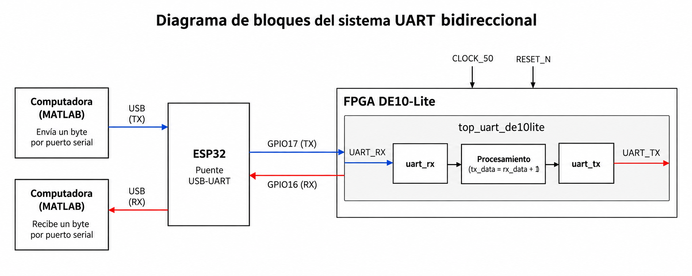
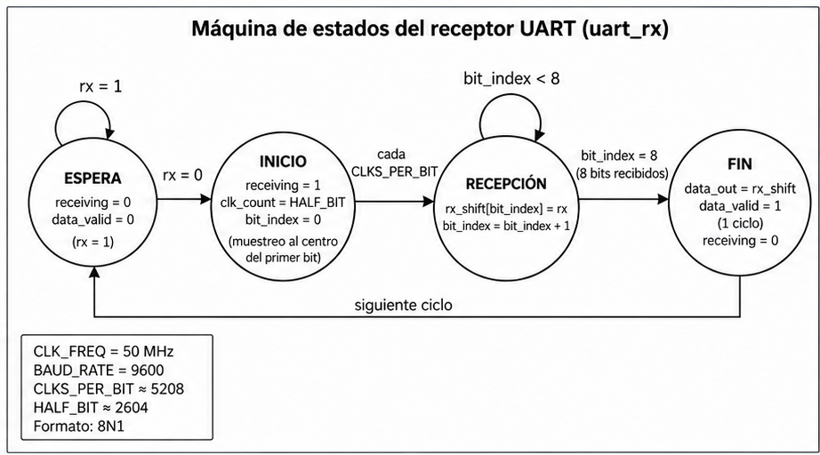
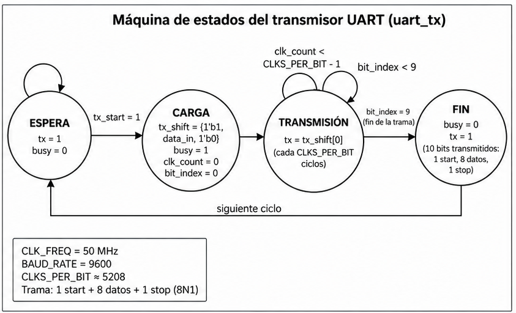

# Práctica 4 — Comunicación UART bidireccional

**Universidad de las Américas Puebla (UDLAP)**  
**Laboratorio de Sistemas Embebidos**

## Descripción

En esta práctica desarrollamos un sistema de comunicación serial bidireccional entre una computadora y la **FPGA DE10-Lite** mediante el protocolo **UART**. Usamos un **ESP32** como puente USB–UART y **MATLAB** para enviar y recibir datos. En la FPGA, los módulos `uart_rx` y `uart_tx` permiten recibir un byte, incrementarlo en una unidad y transmitir la respuesta.

El sistema se configuró a **9600 baudios**, formato **8N1** y reloj de **50 MHz** en la FPGA.

## Diagramas del sistema

### Diagrama de bloques

*Figura 1. Flujo de transmisión y recepción: MATLAB ↔ ESP32 ↔ FPGA DE10-Lite.*

### Máquina de estados del receptor UART

*Figura 2. Etapas funcionales de recepción de un byte mediante `uart_rx`.*

### Máquina de estados del transmisor UART

*Figura 3. Etapas funcionales de transmisión mediante `uart_tx`.*

> Los diagramas de estados resumen el comportamiento del código Verilog; los módulos no declaran una máquina de estados explícita.

## Implementación

El programa del ESP32 se preparó desde **Arduino IDE** para reenviar los bytes entre USB y UART. Las líneas TX y RX se conectaron de forma cruzada:

| ESP32 | FPGA DE10-Lite |
|---|---|
| GPIO17 (TX) | `UART_RX` (entrada) |
| GPIO16 (RX) | `UART_TX` (salida) |

En **Quartus Prime** se integraron los módulos bajo `top_uart_de10lite` y, con **Pin Planner**, se asignaron `CLOCK_50`, `RESET_N`, `UART_RX` y `UART_TX` a los pines correspondientes de la tarjeta.

## Pruebas de laboratorio

Se enviaron valores desde MATLAB para revisar la respuesta de la FPGA:

| Dato enviado | Resultado registrado |
|---|---|
| 2 | 3 |
| 5 | 6 |
| 25 | 26 |
| 255 | Desbordamiento (*overflow*) |

La prueba de 255 permite observar el límite del procesamiento con datos de ocho bits.

## Reporte y evidencia

- **[Ver el reporte en GitHub Pages](https://miliprogramador.github.io/Practica4/)**
- **[Ver el video de resultados en YouTube (A elevado a 5/2)](https://youtu.be/M-FYdOa0AQU)**

## Integrantes

- Diego Garrido Jauckens — 185098
- Sergio Emilio Lopez Montalvo — 186545

**UDLAP · Cholula, Puebla · 2026**
